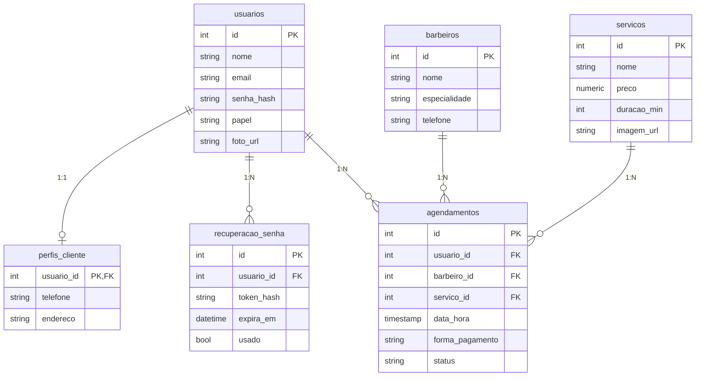

# BarberShop

Sistema web de agendamento para barbearia. Projeto de Desenvolvimento Web I (4º bimestre 2026).

**Aluno:** Eduardo Barzotto Iritsu — **M32**

## Funcionalidades
- **Visão do cliente:** cadastro, login/logout (cookie de sessão, senha guardada com hash bcrypt), recuperação de senha por link de uso único (1h; o link aparece no terminal do servidor), agendar serviço com barbeiro e horário, pagamento **simulado** (Pix, cartão ou dinheiro), ver e cancelar os próprios agendamentos.
- **Visão administrativa:** CRUD de serviços (com upload de imagem), CRUD de barbeiros, lista de todos os agendamentos com mudança de status e faturamento previsto.
- **Regra de negócio (núcleo):** um barbeiro não pode ter dois agendamentos não cancelados no mesmo horário.

## Tecnologias
Node.js, Express 5, express-session (cookies), PostgreSQL (`pg`), bcryptjs, multer, HTML5, CSS e JavaScript.

## Arquitetura (MVC) — estrutura do modelo DW1
```
backend/
  server.js           sobe o servidor, sessão e registra as rotas
  database.js         conexão com o PostgreSQL (.env)
  routes/             mapeamento dos endpoints
  controllers/        regras de negócio e acesso ao banco
  middlewares/        auth (login/admin) e upload de imagens
frontend/
  menu.*              menu principal (início)
  login/              login e cadastro
  recuperar_senha/ redefinir_senha/   recuperação de senha
  servico/ barbeiro/ agendamento/   visão administrativa (html, js e css)
  visaoCliente/       agendar e meus_agendamentos
  app.js              utilitários compartilhados (api, menu, guarda de login)
imagens/servico/      imagens dos serviços (enviadas pelo admin)
imagens/perfil/       fotos de perfil dos usuários
documentacao/         script do banco, tutorial e estrutura
```

## Diagrama do banco


## Como executar
1. Crie o banco: `CREATE DATABASE barbershop4bim;`
2. Rode o script: `psql -U postgres -d barbershop -f documentacao/scriptBarberShop.sql`
3. Copie `.env.example` para `.env` e ajuste `DB_PASSWORD`.
4. `npm install`
5. `npm start` (roda `node backend/server.js`) e abra http://localhost:3000

**Usuários de teste (senha 123456):** `admin@barbershop.com` (admin) e `joao@email.com` (cliente).
