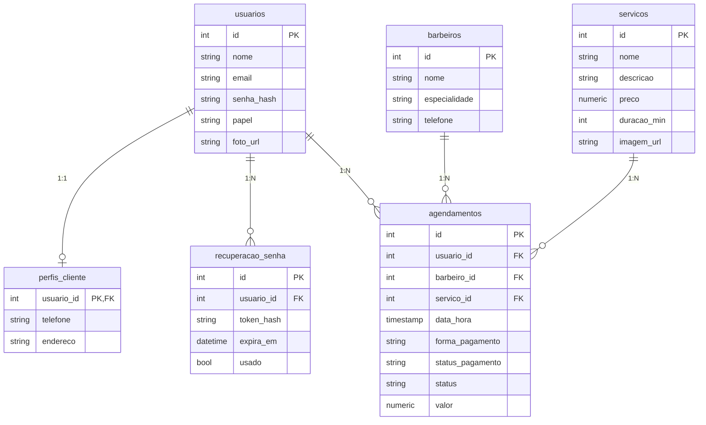

# BarberShop

Sistema web de agendamento para barbearia. Projeto de Desenvolvimento Web I (4º bimestre 2026).

**Aluno:** Eduardo Barzotto Iritsu — **M32**

## Funcionalidades

- **Visão do cliente:** cadastro, login/logout (cookie de sessão, senha guardada com hash bcrypt), recuperação de senha por link de uso único (válido por 1h; o link aparece no terminal do servidor), foto de perfil, agendar serviço escolhendo barbeiro e horário, pagamento **simulado** (Pix, cartão ou dinheiro), ver e cancelar os próprios agendamentos.
- **Visão administrativa:** CRUD de serviços (com upload de imagem), CRUD de barbeiros, lista de todos os agendamentos com mudança de status e faturamento previsto.
- **Regra de negócio (núcleo):** um barbeiro não pode ter dois agendamentos não cancelados no mesmo horário.

## Tecnologias

Node.js, Express 5, express-session (cookies), PostgreSQL (`pg`), bcryptjs, multer, HTML5, CSS e JavaScript.

## Arquitetura (MVC)

```
backend/
  server.js           sobe o servidor, configura a sessão e registra as rotas
  database.js         conexão com o PostgreSQL (variáveis do .env)
  routes/             mapeamento dos endpoints (Router)
  controllers/        regras de negócio e acesso ao banco (Controller)
  middlewares/        auth (login/admin) e upload de imagens
frontend/             páginas HTML, CSS e JS (View)
  menu.*              página inicial
  login/              login e cadastro
  recuperar_senha/ redefinir_senha/   recuperação de senha
  perfil/             perfil e foto do usuário
  servico/ barbeiro/ agendamento/     visão administrativa
  visaoCliente/       agendar e meus_agendamentos
  app.js              utilitários compartilhados (api, menu, guarda de login)
imagens/servico/      imagens dos serviços (enviadas pelo admin)
imagens/perfil/       fotos de perfil dos usuários
documentacao/         script do banco, tutorial, estrutura e wireframes
```

## Wireframes

Esboço das telas principais (cliente e administrador), todas com cabeçalho, menu de navegação e rodapé:


## Diagrama do banco



- **Tabelas independentes:** `servicos` e `barbeiros`
- **1:1:** `usuarios` → `perfis_cliente`
- **1:N:** `usuarios` → `agendamentos`, `barbeiros` → `agendamentos`, `servicos` → `agendamentos`, `usuarios` → `recuperacao_senha`

## Rotas da API

| Método | Rota | Acesso | Função |
| :--- | :--- | :--- | :--- |
| POST | `/api/auth/login` | público | login (cria o cookie de sessão) |
| POST | `/api/auth/logout` | público | logout (destrói a sessão) |
| POST | `/api/auth/registrar` | público | cadastro de cliente |
| GET | `/api/auth/me` | público | usuário logado |
| POST | `/api/auth/esqueci-senha` | público | gera o link de recuperação |
| POST | `/api/auth/redefinir-senha` | público | troca a senha com o token |
| POST / DELETE | `/api/auth/foto` | logado | envia / remove a foto de perfil |
| GET | `/api/servicos` e `/api/barbeiros` | público | listagem |
| POST / PUT / DELETE | `/api/servicos` e `/api/barbeiros` | admin | CRUD |
| POST | `/api/agendamentos` | cliente | cria agendamento (regra do horário) |
| GET | `/api/agendamentos/meus` | cliente | agendamentos do usuário |
| PUT | `/api/agendamentos/:id/cancelar` | cliente | cancela o próprio agendamento |
| GET | `/api/agendamentos` | admin | lista todos |
| PUT | `/api/agendamentos/:id/status` | admin | muda o status |

## Como executar

1. Crie o banco no PostgreSQL: `CREATE DATABASE barbershop4bim;`
2. Rode o script de tabelas e carga inicial: `psql -U postgres -d barbershop -f documentacao/scriptBarberShop.sql`
3. Copie `.env.example` para `.env` e ajuste `DB_PASSWORD` (o `DB_NAME` já é `barbershop4bim`).
4. Instale as dependências: `npm install`
5. Suba o servidor: `npm start` (executa `node backend/server.js`) e abra http://localhost:3000

**Usuários de teste (senha `123456`):**
- `admin@barbershop.com` (administrador)
- `joao@email.com` (cliente)
